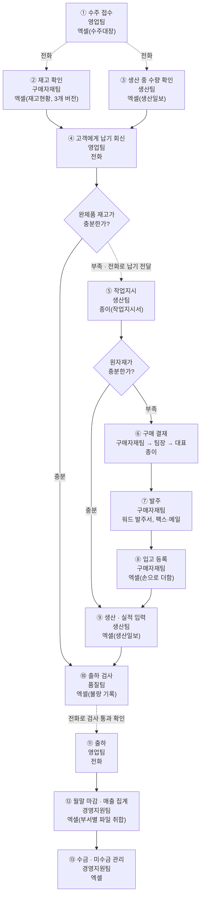
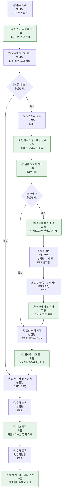

# 업무 흐름: 현행과 목표 (수주 → 수금)

> 가상 회사 실습용 자료입니다. [부서별 인터뷰 메모](부서별_인터뷰메모.md)와 [요구사항 정의서](02_요구사항정의서.md)를 바탕으로 정리했습니다.

- [1. 현행 업무 흐름](#1-현행-업무-흐름) — 지금 일하는 방식
- [2. 목표 업무 흐름](#2-목표-업무-흐름) — ERP를 도입한 뒤 일하는 방식

## 1. 현행 업무 흐름

지금 누리정밀에서 주문 하나가 돈이 되어 돌아오기까지의 흐름이에요.
상자에는 **담당 부서**와 **쓰는 도구**를 줄을 나눠 적었어요.
**점선 화살표는 전화로 확인하는 곳**이에요.

### 현행: 단계별 정리

| 단계 | 담당 | 도구 | 문제 |
|------|------|------|------|
| ① 수주 접수 | 영업팀 | 엑셀(수주대장) | 납기일을 적어도 생산팀은 보지 않는다. 고객사별 단가가 달라 견적 때마다 단가표를 찾는다. |
| ② 재고 확인 | 구매자재팀 | 엑셀(재고현황), 전화 | 재고 파일이 3개 버전이라 어느 게 최신인지 모른다. 월말 실사와 5~10% 차이가 난다. |
| ③ 생산 중 수량 확인 | 생산팀 | 엑셀(생산일보), 전화 | 영업팀이 전화로 물어봐야만 알 수 있다. |
| ④ 고객에게 납기 회신 | 영업팀 | 전화 | 답하는 데 반나절에서 하루가 걸린다. 지난달 납기 지연 3건, 그중 1건은 위약금이 나왔다. |
| ⑤ 작업지시 | 생산팀 | 종이(작업지시서), 전화 | 급한 주문으로 순서가 바뀌면 현장 전달이 늦다. 제품별 재료 목록(BOM) 엑셀이 오래됐다. |
| ⑥ 구매 결재 | 구매자재팀 → 팀장 → 대표 | 종이 | 대표가 출장 중이면 결재가 며칠씩 밀린다. |
| ⑦ 발주 | 구매자재팀 | 워드, 팩스·메일 | 안전재고 기준이 담당자 머릿속에만 있다. 올해 원자재가 바닥난 걸 라인이 멈춘 뒤에야 안 적이 2번 있다. |
| ⑧ 입고 등록 | 구매자재팀 | 엑셀(손으로 더함) | 손으로 더하다 보니 실제 수량과 어긋나기 쉽다. |
| ⑨ 생산 · 실적 입력 | 생산팀 | 엑셀(생산일보) | 하루가 끝나고 몰아서 입력해 지금 몇 개 만들었는지 모른다. |
| ⑩ 출하 검사 | 품질팀 | 엑셀(불량 기록) | 불량 기록이 품질팀 엑셀에만 있어 영업팀은 모른다. |
| ⑪ 출하 | 영업팀 | 전화 | 검사 통과 여부를 출하 직전에 전화로 확인한다. |
| ⑫ 월말 마감 · 매출 집계 | 경영지원팀 | 엑셀(부서별 파일 취합) | 마감에 3일이 걸린다. 부서별 숫자가 서로 안 맞을 때가 많다. |
| ⑬ 수금 · 미수금 관리 | 경영지원팀 | 엑셀 | 대표가 미수금을 물어도 바로 답하지 못한다. |
| **요약** | **5개 부서 + 대표 결재** | **엑셀 8단계, 전화 확인 화살표 4곳, 종이 2단계** | **같은 정보가 부서마다 따로 있어 전화로 묻고 손으로 옮긴다. → 입력은 한 번, 조회는 모두가 할 수 있어야 한다.** |

### 현행: 참고

- 인사·급여는 별도 프로그램을 쓰고 있어 이 흐름에서 뺐어요.
- ⑬ 수금 단계의 도구는 메모에 따로 나오지 않아요. 월말에 부서별 엑셀을 모은다는 내용을 보고 엑셀로 적었어요.
- 메모의 "확인 필요" 항목(위약금 기준, 안전재고 수치, 단가 변경 주기)은 아직 정해지지 않았어요.

---

## 2. 목표 업무 흐름

ERP를 도입한 뒤 같은 주문 하나가 흘러가는 모습이에요.
모든 부서가 **ERP 하나**에 입력하고, 같은 화면을 봐요.
**초록 상자는 시스템이 자동으로 하는 단계**예요. 상자 안에도 "자동"이라고 적었어요.
갈림길은 두 곳이에요. **완제품 재고가 충분한가?**와 **원자재가 충분한가?**예요.
전화로 확인하는 화살표는 하나도 없어요.

### 목표: 단계별 정리

요구사항 번호는 [요구사항 정의서](02_요구사항정의서.md)의 ID예요.

| 단계 | 담당 | 도구 | 바뀌는 점 | 요구사항 |
|------|------|------|-----------|----------|
| ① 수주 등록 | 영업팀 | ERP | 등록된 품목·거래처에서 골라 입력한다. 납기가 생산팀에도 바로 보인다. | REQ-001, REQ-002 |
| ② 출하 가능 수량 계산 | **자동** | ERP | 재고와 생산 중 수량을 시스템이 합쳐 보여 준다. 전화 2통이 사라진다. | REQ-003 |
| ③ 고객에게 납기 회신 | 영업팀 | ERP 화면 | 반나절~하루 걸리던 답을 바로 한다. | REQ-003 |
| ◇ 완제품 재고가 충분한가? | 영업팀 | ERP 화면 | ②에서 계산한 수량으로 바로 판단한다. | REQ-003 |
| ④ 작업지시 등록 | 생산팀 | ERP | 종이 작업지시서가 없어진다. | REQ-008 |
| ⑤ 납기순 정렬 · 현장 공유 | **자동** | ERP (휴대폰) | 급한 주문이 자동으로 위로 올라간다. 현장은 조회만 한다. | REQ-008, REQ-012, REQ-015 |
| ⑥ 필요 원자재 계산 | **자동** | ERP | 제품별 재료 목록(BOM)으로 필요한 원자재를 계산한다. | REQ-007 |
| ◇ 원자재가 충분한가? | 생산팀 | ERP 화면 | ⑥의 필요량과 원자재 재고를 비교해 판단한다. | REQ-004, REQ-007 |
| ⑦ 원자재 부족 경고 | **자동** | 대시보드 | 안전재고 아래로 내려가면 라인이 멈추기 전에 알려 준다. | REQ-005 |
| ⑧ 발주 결재 | 구매자재팀 → 부서장 → 대표 | ERP 결재함 | 종이 결재가 없어진다. 대표가 출장 중이어도 결재할 수 있다. | REQ-012, REQ-013 |
| ⑨ 발주 등록 · 입고 처리 | 구매자재팀 | ERP | 워드·팩스 대신 ERP에 발주하고, 입고를 발주와 연결한다. | REQ-006 |
| ⑩ 원자재 재고 증가 · 매입 기록 | **자동** | ERP | 손으로 엑셀에 더하지 않는다. 매입도 자동으로 남는다. | REQ-004, REQ-010 |
| ⑪ 생산 실적 입력 | 생산팀 | ERP (휴대폰 가능) | 하루 끝에 몰아서 쓰지 않고 그때그때 입력한다. | REQ-009, REQ-015 |
| ⑫ 완제품 재고 증가 · 원자재 차감 | **자동** | ERP | 실적만 넣으면 재고 두 가지가 BOM대로 함께 바뀐다. | REQ-004, REQ-009 |
| ⑬ 출하 검사 결과 등록 | 품질팀 | ERP | 검사 결과가 출하 화면에 붙어 전화 확인이 사라진다. (확장 항목) | REQ-016 |
| ⑭ 출하 등록 | 영업팀 | ERP | 출하 화면에서 검사 결과를 보고 바로 내보낸다. | REQ-004, REQ-016 |
| ⑮ 재고 차감 · 매출 · 미수금 기록 | **자동** | ERP | 출하와 동시에 재고·매출·미수금이 맞춰진다. | REQ-004, REQ-010 |
| ⑯ 수금 등록 | 경영지원팀 | ERP | 돈이 들어오면 입력하고, 미수금이 바로 줄어든다. | REQ-011 |
| ⑰ 월 합계 · 대시보드 갱신 | **자동** | 대시보드 (휴대폰) | 3일 걸리던 월말 마감이 버튼 한 번이 된다. 대표가 매출·재고 경고·미수금을 한 화면에서 본다. | REQ-011, REQ-014, REQ-015 |
| **요약** | **5개 부서 + 대표, 자동 8단계** | **ERP 하나** (엑셀 8단계 → 0, 전화 4곳 → 0, 종이 2단계 → 0) | **입력은 한 번, 나머지는 시스템이 자동으로 이어 준다.** | **필수 15개 전부 + 확장 1개(REQ-016)** |

### 목표: 참고

- REQ-016(출하 검사 결과 표시)은 정의서에서 "확장" 항목이에요. 시간이 모자라면 ⑬은 빠지고, ⑭에서 검사 결과 없이 출하해요.
- REQ-017(직원 명부·근태)은 수주→수금 흐름과 관계가 없어 그림에 넣지 않았어요.
- 정의서의 "제외" 항목(급여 계산, 세금계산서, 위약금 계산 등)도 그림에 넣지 않았어요.
- ⑦의 안전재고 기준은 정의서 4장에 따라 "2주 사용량"을 가정으로 써요. 구매자재팀장 확인이 필요해요.
