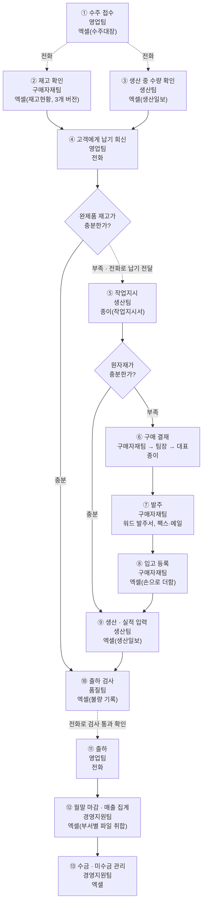

# 현행 업무 흐름 (수주 → 수금)

> 가상 회사 실습용 자료입니다. [부서별 인터뷰 메모](부서별_인터뷰메모.md)를 바탕으로 정리했습니다.

지금 누리정밀에서 주문 하나가 돈이 되어 돌아오기까지의 흐름이에요.
상자에는 **담당 부서**와 **쓰는 도구**를 줄을 나눠 적었어요.
**점선 화살표는 전화로 확인하는 곳**이에요.

## 단계별 정리

| 단계 | 담당 | 도구 | 문제 |
|------|------|------|------|
| ① 수주 접수 | 영업팀 | 엑셀(수주대장) | 납기일을 적어도 생산팀은 보지 않는다. 고객사별 단가가 달라 견적 때마다 단가표를 찾는다. |
| ② 재고 확인 | 구매자재팀 | 엑셀(재고현황), 전화 | 재고 파일이 3개 버전이라 어느 게 최신인지 모른다. 월말 실사와 5~10% 차이가 난다. |
| ③ 생산 중 수량 확인 | 생산팀 | 엑셀(생산일보), 전화 | 영업팀이 전화로 물어봐야만 알 수 있다. |
| ④ 고객에게 납기 회신 | 영업팀 | 전화 | 답하는 데 반나절에서 하루가 걸린다. 지난달 납기 지연 3건, 그중 1건은 위약금이 나왔다. |
| ⑤ 작업지시 | 생산팀 | 종이(작업지시서), 전화 | 급한 주문으로 순서가 바뀌면 현장 전달이 늦다. 제품별 재료 목록(BOM) 엑셀이 오래됐다. |
| ⑥ 구매 결재 | 구매자재팀 → 팀장 → 대표 | 종이 | 대표가 출장 중이면 결재가 며칠씩 밀린다. |
| ⑦ 발주 | 구매자재팀 | 워드, 팩스·메일 | 안전재고 기준이 담당자 머릿속에만 있다. 올해 원자재가 바닥난 걸 라인이 멈춘 뒤에야 안 적이 2번 있다. |
| ⑧ 입고 등록 | 구매자재팀 | 엑셀(손으로 더함) | 손으로 더하다 보니 실제 수량과 어긋나기 쉽다. |
| ⑨ 생산 · 실적 입력 | 생산팀 | 엑셀(생산일보) | 하루가 끝나고 몰아서 입력해 지금 몇 개 만들었는지 모른다. |
| ⑩ 출하 검사 | 품질팀 | 엑셀(불량 기록) | 불량 기록이 품질팀 엑셀에만 있어 영업팀은 모른다. |
| ⑪ 출하 | 영업팀 | 전화 | 검사 통과 여부를 출하 직전에 전화로 확인한다. |
| ⑫ 월말 마감 · 매출 집계 | 경영지원팀 | 엑셀(부서별 파일 취합) | 마감에 3일이 걸린다. 부서별 숫자가 서로 안 맞을 때가 많다. |
| ⑬ 수금 · 미수금 관리 | 경영지원팀 | 엑셀 | 대표가 미수금을 물어도 바로 답하지 못한다. |
| **요약** | **5개 부서 + 대표 결재** | **엑셀 8단계, 전화 확인 화살표 4곳, 종이 2단계** | **같은 정보가 부서마다 따로 있어 전화로 묻고 손으로 옮긴다. → 입력은 한 번, 조회는 모두가 할 수 있어야 한다.** |

## 참고

- 인사·급여는 별도 프로그램을 쓰고 있어 이 흐름에서 뺐어요.
- ⑬ 수금 단계의 도구는 메모에 따로 나오지 않아요. 월말에 부서별 엑셀을 모은다는 내용을 보고 엑셀로 적었어요.
- 메모의 "확인 필요" 항목(위약금 기준, 안전재고 수치, 단가 변경 주기)은 아직 정해지지 않았어요.
